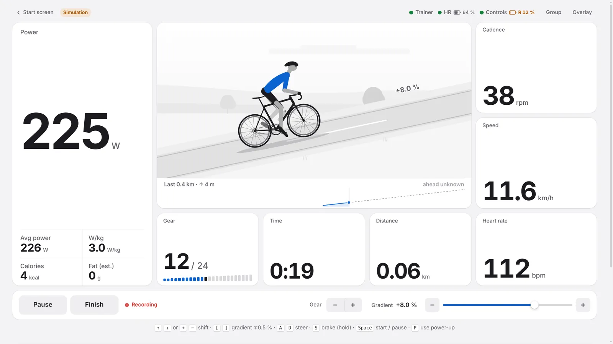
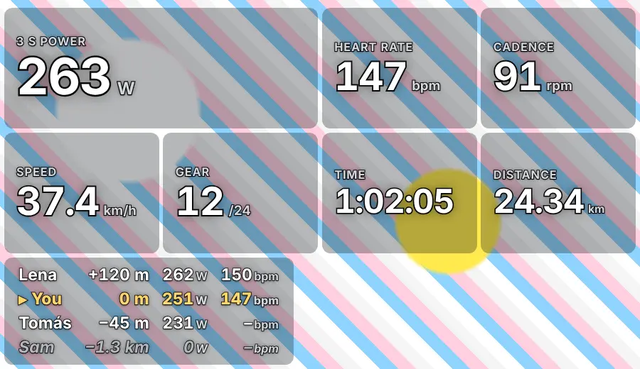
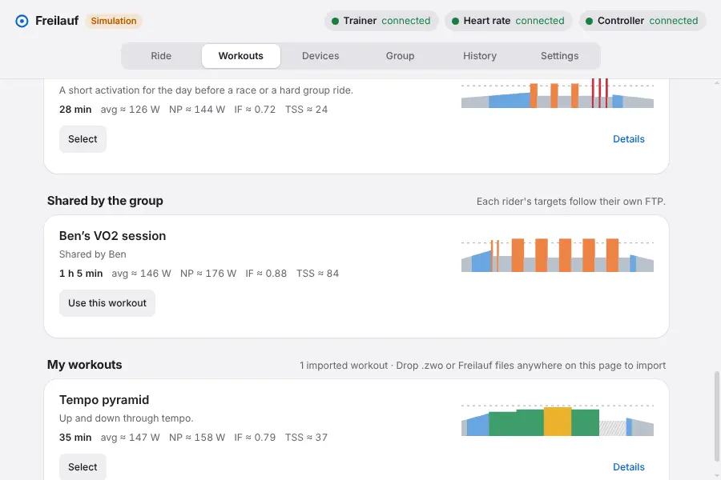

<p align="center">
  
</p>

<h1 align="center">Freilauf</h1>

<p align="center">
  <strong>Indoor cycling without the virtual world — your own video, your friends, your data.</strong>
</p>

<p align="center">
  Open source (MIT) · local-first · no account · no telemetry · early and honest about it
</p>

<p align="center">
  <a href="https://graemer-org.github.io/freilauf/">Website</a> ·
  <a href="#get-it">Get it</a> ·
  <a href="#ride-with-friends">Ride with friends</a> ·
  <a href="#join-in">Join in</a> ·
  <a href="docs/README.md">Docs</a>
</p>

Freilauf is a small desktop app for riding a smart trainer at home. It connects to your
trainer, heart-rate strap and handlebar controllers, shifts gears in software, and lays a
transparent stats overlay over whatever is already on your screen.

It starts in seconds and needs no account. Put on a film, a race or a playlist, and ride
over it. Friends join with a six-letter code and ride with you peer-to-peer. Everything you
ride stays on your machine, as plain files in open formats.

<p align="center">
  <picture>
    <source media="(prefers-color-scheme: dark)" srcset="docs/assets/screenshots/ride-climb-dark.webp">
    
  </picture>
</p>

<p align="center"><sub>Screenshots are taken in simulation mode (note the “Simulation” badge), which runs the whole app without hardware.</sub></p>

## What it does

|                                                                                                                                                                                                                                               |                                                                                                                                                                                                                                     |
| --------------------------------------------------------------------------------------------------------------------------------------------------------------------------------------------------------------------------------------------- | ----------------------------------------------------------------------------------------------------------------------------------------------------------------------------------------------------------------------------------- |
|  | **An overlay over anything.** A transparent, always-on-top, click-through window with the numbers you choose, on top of a fullscreen video or any other app. A hotkey (`Ctrl/Cmd+Shift+O`) toggles edit mode to move and resize it. |
|                  | **Structured workouts in ERG mode.** The trainer holds the target power. Import `.zwo` files, use the built-in library, or measure your FTP with a 20-minute or a ramp test.                                                        |
|                                                                   | **Group rides, peer-to-peer.** Up to eight riders in a room over WebRTC. Share a workout with the group and start it together on a countdown.                                                                                       |
|                        | **Your library, in open formats.** Drop `.zwo` files onto the window; workouts shared in a group show up next to your own. Every ride is recorded locally and exports to `.fit`.                                                    |

And underneath:

- **Trainer control over standard Bluetooth FTMS**, heart rate over the standard Heart Rate
  Service, and handlebar controllers of a smart frame with configurable button actions.
- **Virtual shifting in software**: 24 gears, expressed through FTMS simulation parameters, so
  a single-cog bike feels like it has a full cassette ([ADR 0002](docs/adr/0002-virtual-shifting.md)).
- **Free ride with gradient**, and an animated ride scene with an elevation profile and
  steering.
- **An always-on diagnostic log** that leaves out your name and ride data, made to be attached
  to a bug report ([diagnostics](docs/diagnostics.md)).
- **A browser version** you can run with Docker Compose, for example on a home server
  ([docker](docs/docker.md)).

## Status

Freilauf is **early**. There are no published releases yet. Everything above is built and
tested end to end against simulated devices — about 650 unit tests, plus Playwright tests that
drive the desktop app and the browser build — but very little has met real hardware so far.

**First real-hardware test — 22 November 2026, Windows 11, Wahoo KICKR CORE, Zwift Ride smart
frame, a Bluetooth heart-rate strap:**

- Pairing worked for all three kinds of device.
- Shifting from the frame's controllers worked with **one button per side** (the lower shift
  button on each grip).
- The **second shift button on each side and the other controller buttons are not decoded or
  mapped yet**. Keyboard shifting works regardless
  ([protocol notes](docs/protocols/zwift-ride.md)).
- How the overlay behaves over fullscreen video on Windows and macOS has **not been confirmed**
  yet.

**Not tried on real hardware at all yet:** ERG workouts on a real trainer, the FTP tests,
steering with the controllers, group rides between different machines and networks (so far
only on one machine), building the Docker image, and macOS in general.

**Community features** — points, weekly and monthly totals, friends with per-contact
visibility, challenges and leaderboards that sync peer-to-peer without a server: the core
library is implemented and tested ([`packages/community`](packages/community),
[design](docs/community.md)) and wired into the app (rides count towards your totals, group
sessions sync standings and challenges in the background); the Community tab (UI) is in
progress, so there is nothing to see in the app yet.

## Get it

**From source (works today).** You need Node.js ≥ 22.18 and pnpm 10 (`corepack enable` picks
up the pinned version).

```sh
git clone https://github.com/graemer-org/freilauf.git
cd freilauf
pnpm install
pnpm dev:sim     # try everything with a simulated trainer, heart-rate strap and controller
pnpm dev         # ride with real Bluetooth devices
pnpm dist        # build an installer for your system (apps/desktop/release/<version>)
```

**Installers.** Windows, macOS and Linux installers are built with electron-builder, but none
have been published yet. When they are, they will be **unsigned**: Windows SmartScreen and
your browser will warn about an unknown publisher, and macOS Gatekeeper will refuse to open the
app until you allow it. [docs/releasing.md](docs/releasing.md) explains what to click.

**In the browser.** `docker compose up -d` serves a web version on port 8080, including the
group-ride signalling server. Bluetooth in the browser needs Chrome or Edge and HTTPS (or
`localhost`), and the stats overlay becomes a small pop-out window instead of a transparent one.
See [docs/docker.md](docs/docker.md).

## Ride with friends

1. One rider creates a group in the **Group** tab and gets a six-letter room code.
2. Everyone else enters the code (or opens the join link) and is connected **directly** to
   every other rider over WebRTC: power, speed, heart rate and position go from rider to rider,
   not through a server.
3. Share a workout with the group, and start it together on a countdown. Each rider's targets
   follow their own FTP.

The only server involved is a **tiny signalling server** that introduces the riders to each
other and relays the connection handshake. It stores nothing and sees no ride data. The project
does not run a public one yet, so one of you runs it — `pnpm signalling`, its
[Docker image](apps/signalling/README.md), or the browser version's container, which includes
it — and everyone points the app at it (Settings → Group).

Connections use public STUN servers and no TURN relay, so riders behind some networks
(symmetric NAT, common on mobile carriers and some company or university networks) will not
be able to connect. The details, limits and the wire protocol are in [docs/p2p.md](docs/p2p.md).

## Join in

Freilauf is built in the open, and right now the most valuable thing anyone can do is ride it
on real hardware and tell us what happened. You do not need to write code.

**Most wanted right now**

- **Hardware test reports**, with the diagnostic log — especially **controller button
  captures** (the steps are in the [protocol notes](docs/protocols/zwift-ride.md#how-to-capture)),
  and **other trainers**: any trainer that speaks Bluetooth FTMS should work, but only one has
  been tried.
- **Protocol notes**: what you have learned from your own captures, with sources and a
  confidence level, in [`docs/protocols/`](docs/protocols).
- **Workouts**: original `.zwo` workouts you are happy to publish under the MIT licence.
- **Design**: the app's look, the overlay, the ride scene, this README.
- **Translations** — later, once the text settles; say hello if you want to help.

**Reporting a hardware test.** Open an issue and include:

- your operating system and version, and whether you used the desktop app or the browser
  version (which browser);
- the devices: trainer, heart-rate strap, controllers, with model and firmware if you know it;
- what you did, what you expected, and what happened — for buttons, the order you pressed them
  in;
- the **diagnostic log**: `freilauf.log` (and any `freilauf.N.log`) from the `logs` folder in
  Freilauf's settings folder — [where to find it](docs/diagnostics.md#where-it-is). It leaves
  out your name, ride data and room codes, but have a quick look before posting
  ([what is in it](docs/diagnostics.md#what-is-in-the-log)).

Code contributions are welcome too; [CONTRIBUTING.md](CONTRIBUTING.md) has the setup and the
few rules.

### Principles

- **Local-first.** Rides, settings and workouts live on your machine. No account, no backend,
  no telemetry.
- **Open formats.** `.fit` for rides, `.zwo` for workouts, and documented wire protocols for
  group rides and device notes.
- **Clean-room protocol work.** Device protocols are learned from specifications, public
  write-ups and our own captures, then implemented independently. No code from GPL-licensed
  projects, not even small snippets.
- **MIT**, for everything in this repository.

## Roadmap

Next, roughly in this order of interest — none of it is built yet:

- GPX routes driving the gradient, with a map
- Drafting in group rides
- Strava upload
- A Wi-Fi connection to the trainer (Direct Connect, GATT over TCP)
- Signed installers
- An optional always-on relay peer that keeps friends' leaderboard values available when
  nobody else is online ([design](docs/community.md#an-optional-always-on-relay-peer-not-implemented))

## Architecture

- A pnpm workspace in TypeScript: portable core packages (`devices`, `sim`, `session`, `p2p`,
  `workouts`, `community`) with no Electron, DOM or Node dependencies, tested with Vitest.
- `apps/desktop` is the Electron app (main window, overlay, Bluetooth chooser), `apps/web` the
  browser build, `apps/signalling` the WebSocket relay for group rides.
- Two device layers: a GATT-shaped transport (Web Bluetooth today) and device drivers on top;
  every device has a simulated counterpart ([ADR 0001](docs/adr/0001-architecture.md)).
- Virtual shifting scales the road sent to the trainer as FTMS simulation parameters
  ([ADR 0002](docs/adr/0002-virtual-shifting.md)).
- Group rides are a WebRTC mesh; ride data never touches a server ([p2p](docs/p2p.md)).

Commands, environment variables and the full documentation index: [docs/README.md](docs/README.md).

## Licence and disclaimer

[MIT](LICENSE) © 2026 Freilauf contributors.

Freilauf is an independent project. It is not affiliated with, endorsed by or sponsored by
Wahoo Fitness, Zwift, Strava or any other company mentioned here. Product names and trademarks
belong to their owners and are used only to describe compatibility.

Indoor training is strenuous. Ride within your limits, and check with a doctor if you are
unsure.
