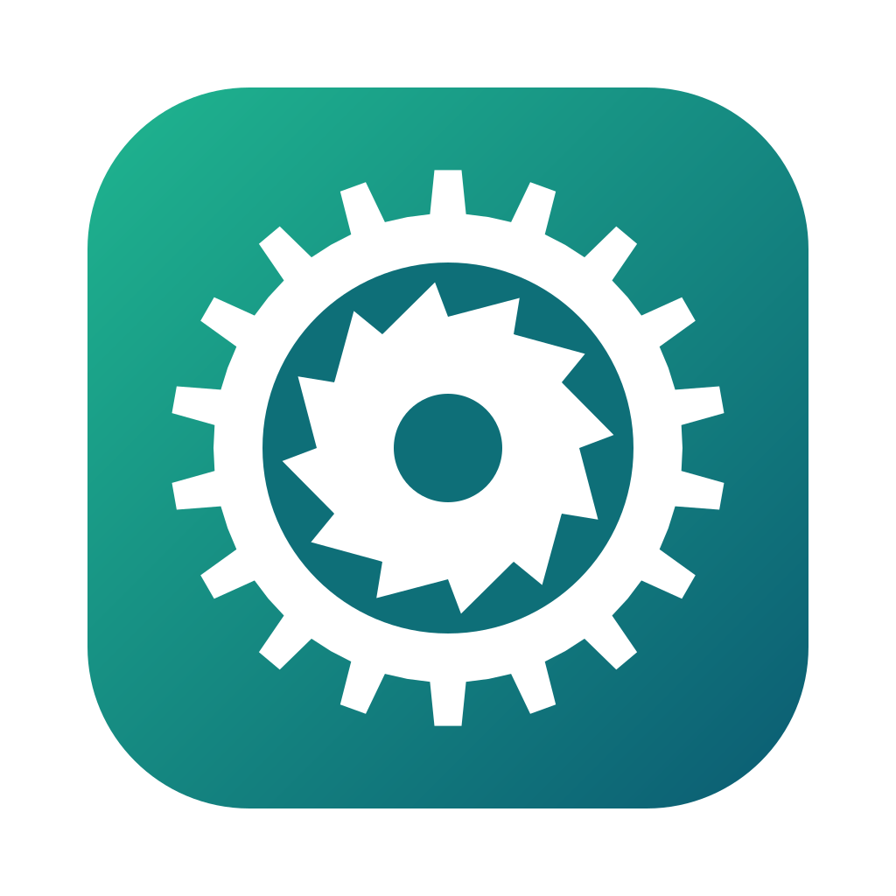
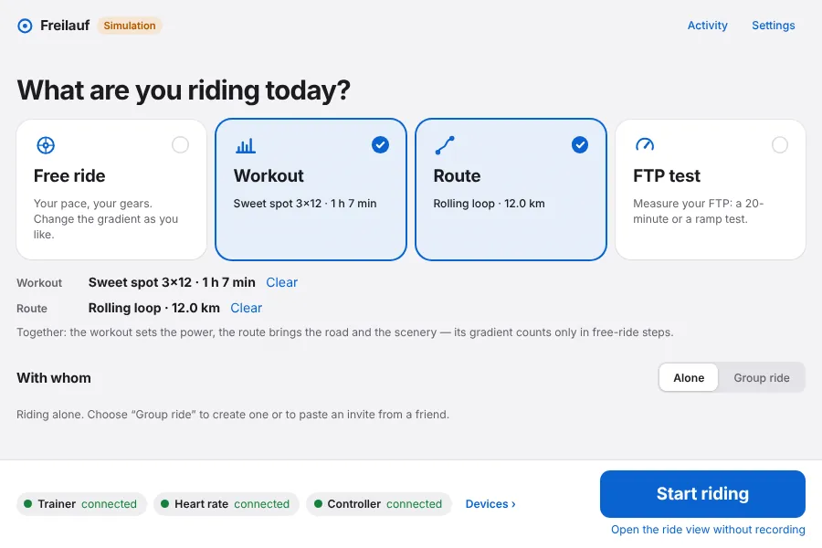
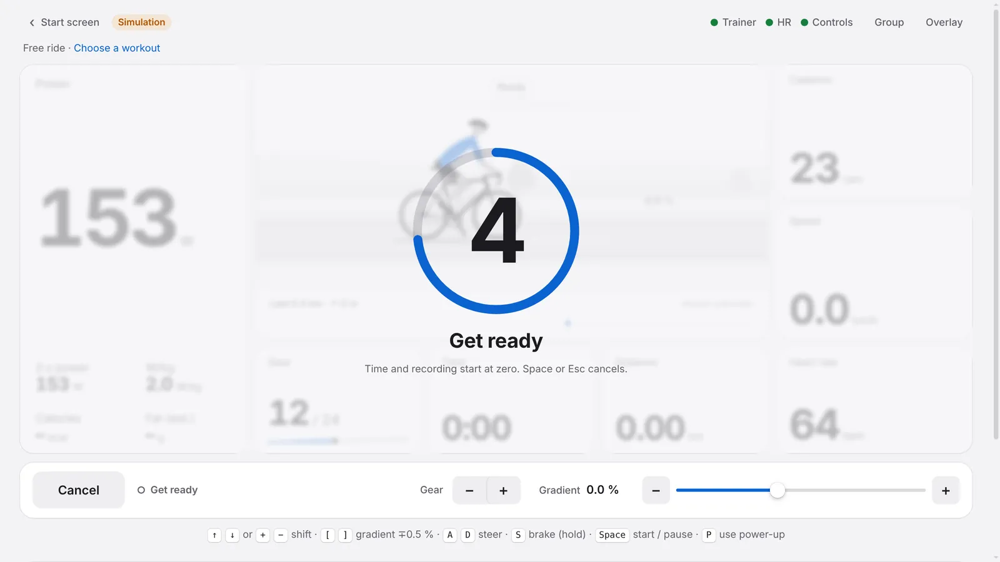
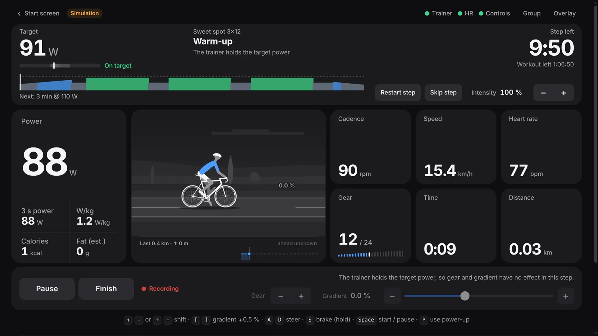
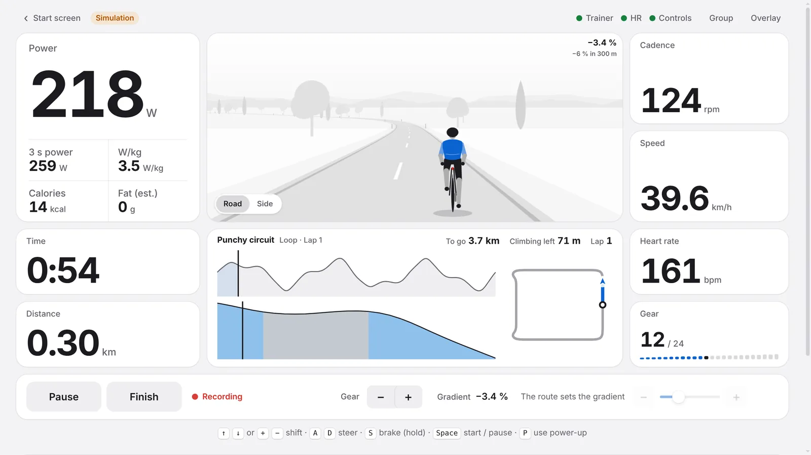
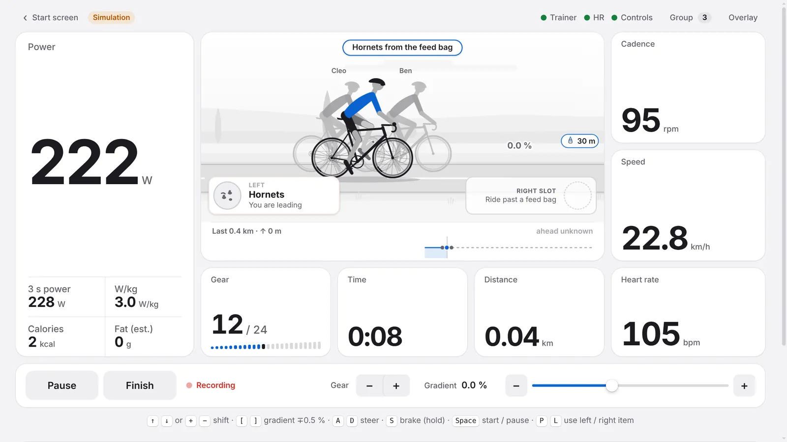
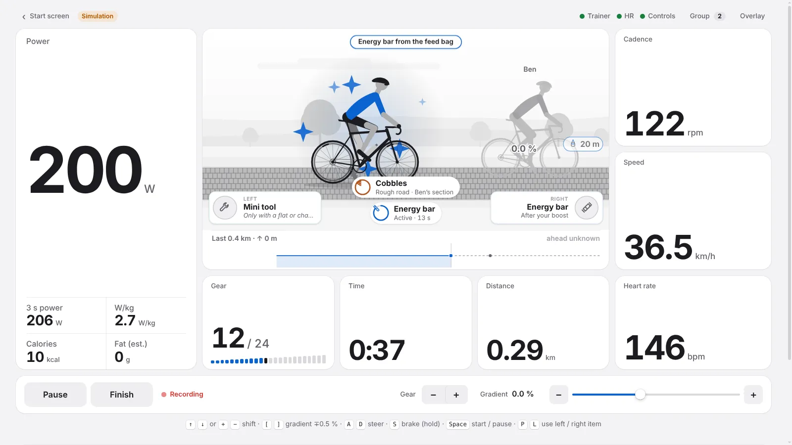
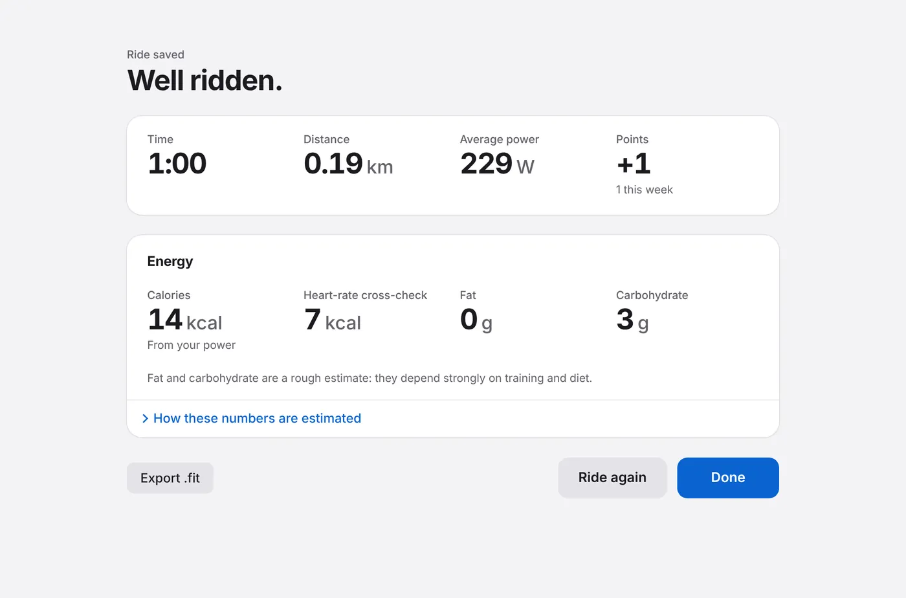
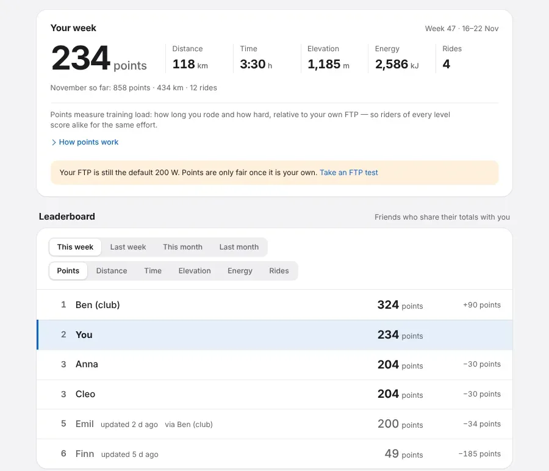

<p align="center">
  
</p>

<h1 align="center">Freilauf</h1>

<p align="center">
  <strong>Indoor cycling without the virtual world — your own video, your friends, your data.</strong>
</p>

<p align="center">
  Open source (MIT) · local-first · no account · no telemetry · early and honest about it
</p>

<p align="center">
  <a href="https://graemer-org.github.io/freilauf/">Website</a> ·
  <a href="docs/getting-started.md">Getting started</a> ·
  <a href="#get-it">Get it</a> ·
  <a href="#ride-with-friends">Ride with friends</a> ·
  <a href="#join-in">Join in</a> ·
  <a href="docs/README.md">Docs</a>
</p>

Freilauf is a small desktop app for riding a smart trainer at home. It connects to your
trainer, heart-rate strap and the handlebar controllers of a smart frame, shifts gears in
software, and lays a transparent stats overlay over whatever is already on your screen.

It starts in seconds and needs no account. Put on a film, a race or a playlist, and ride
over it — or ride a real route from a GPX file, a structured workout, or a playful race with
friends. Friends join with an invite link and ride with you peer-to-peer. Everything you
ride stays on your machine, as plain files in open formats.

<p align="center">
  <picture>
    <source media="(prefers-color-scheme: dark)" srcset="docs/assets/screenshots/ride-climb-dark.webp">
    
  </picture>
</p>

<p align="center"><sub>Screenshots are taken in simulation mode (note the “Simulation” badge), which runs the whole app without hardware.</sub></p>

## What it does

|                                                                                                                                                                                                                                                                                                                          |                                                                                                                                                                                                                                                                                                                                                                     |
| ------------------------------------------------------------------------------------------------------------------------------------------------------------------------------------------------------------------------------------------------------------------------------------------------------------------------ | ------------------------------------------------------------------------------------------------------------------------------------------------------------------------------------------------------------------------------------------------------------------------------------------------------------------------------------------------------------------- |
|                          | **Choose, then ride.** Freilauf opens on one start screen: free ride, a workout, a GPX route or an FTP test — alone or with friends — and one **Start riding** button. Devices, Activity and Settings are a click away; the ride itself fills the window.                                                                                                           |
|                                                                                          | **A countdown before you go.** Starting or resuming counts down (off, 3, 5 or 10 s; 3 by default) in the ride view and the overlay; time and recording begin at zero. Press Start again or <kbd>Esc</kbd> to cancel.                                                                                                                                                |
|                                                                             | **An overlay over anything.** A transparent, always-on-top, click-through window with the numbers you choose, on top of a fullscreen video or any other app. A hotkey (`Ctrl/Cmd+Shift+O`) toggles edit mode to move and resize it.                                                                                                                                 |
|                 | **Structured workouts in ERG mode.** The trainer holds the target power. Import `.zwo` files, use the built-in library, measure your FTP with a 20-minute or a ramp test, and share a workout with your group ([workouts](docs/workouts.md)).                                                                                                                       |
|  | **Real routes from GPX.** Import a GPX file or pick a built-in route: its gradient drives the trainer, and the ride scene shows the road from behind the rider, bending and climbing as the route does. Click the profile or the map to start or jump anywhere; loops count laps, and the `.fit` file gets a lap per jump ([routes](docs/routes.md)).               |
|                                                                                   | **Group rides, peer-to-peer.** Up to eight riders, connected directly over WebRTC. By default the apps find each other through public relays — no server to run, just an invite link — or through your own signalling server. Share a workout or a route and start together on a countdown ([ride with friends](docs/group-rides.md)).                              |
|                                     | **Power-ups and Freilauf Rumble.** Collect a power-up on the road or earn one with a short effort. In a Rumble, ride past feed bags for items — water bottle, mud puddle, hornets, rain cape — held in two slots. Items only move race positions; the recording and the `.fit` file stay your own power ([power-ups](docs/power-ups.md), [Rumble](docs/rumble.md)). |
|               | **A short summary, honest numbers.** After Finish: time, distance, power, points, personal bests, and calories with a rough fat / carbohydrate split ([energy](docs/energy.md)). Every ride is recorded locally and exports to `.fit`.                                                                                                                              |
|                                        | **Points, leaderboards and challenges — without a server.** Points measure load relative to your own FTP (an hour at FTP is 100). Friends' standings and challenges travel peer-to-peer whenever you ride together, and you choose per friend what they may see ([community](docs/community.md)).                                                                   |

And underneath:

- **Trainer control over standard Bluetooth FTMS**, heart rate over the standard Heart Rate
  Service, and the handlebar controllers of a smart frame: all buttons with configurable
  actions, and the two analog levers for braking and steering. Paired devices are remembered and
  **reconnect** on their own when the link drops.
- **Virtual shifting in software**: 24 gears, expressed through FTMS simulation parameters, so
  a single-cog bike feels like it has a full cassette ([ADR 0002](docs/adr/0002-virtual-shifting.md)).
- **Free ride with gradient**, **braking** (slows the virtual bike only) and **steering**, in an
  animated side-on scene with an elevation profile; on a route, a road view from behind the rider.
  Keyboard shortcuts for all of it.
- **Share with my watch** (Windows): the app also acts as a Bluetooth power meter, heart-rate
  and speed/cadence sensor, so a sports watch records the ride too ([watch relay](docs/watch-relay.md)).
- **An always-on diagnostic log** that leaves out your name and ride data, made to be attached
  to a bug report: Settings → Diagnostics exports it, copies the recent part or opens its folder
  ([diagnostics](docs/diagnostics.md)).
- **A browser version** you can run with Docker Compose, for example on a Synology NAS
  ([docker](docs/docker.md)).

## Status

Freilauf is **early**. There are no published releases yet. Everything above is built and
tested end to end against simulated devices — over 1,500 unit tests, plus Playwright tests that
drive the desktop app (several app instances at once for group rides) and the browser build.
Some of it has now met real hardware; much has not.

**Verified on real hardware** (tested with Windows 11, a Wahoo KICKR CORE, the handlebar
controllers of a Zwift Ride smart frame and a Bluetooth heart-rate strap):

- Pairing and connecting the trainer, the heart-rate strap and the controllers.
- **Virtual shifting** on the trainer.
- **All controller buttons** (all sixteen, including Z and the right power button) and **both
  levers** (one per grip, moving both ways), with the default assignment of braking and steering
  confirmed by the tester; it can be swapped or reassigned under Devices → Controllers
  ([protocol notes](docs/protocols/zwift-ride.md)).
- **A 60-minute real ride**, recorded and exported as a `.fit` file. The issues it found
  (trainer commands during fast shifting, dropped links during the first connect, an empty lap
  in the `.fit` file) were fixed afterwards.

**Not yet verified on real hardware or real networks:**

- **Group rides over the public relays between two real machines** on different networks (so
  far only several app instances on one machine, over a local server).
- **Share with my watch** on Windows with a real sports watch.
- **Power-ups and Freilauf Rumble between real machines**, and community standings and
  challenges syncing between real machines.
- **ERG workouts, the FTP tests, the overlay over fullscreen video, and riding a route** in
  practice, on a real trainer.
- The Docker image on a real NAS, the installers, and macOS in general.

**Not built yet:** uploading to Strava directly — today you export the `.fit` file and upload
it by hand.

## Get it

New here? [Getting started](docs/getting-started.md) walks from the first build to pairing,
the start screen, the overlay and simulation mode.

**From source (works today).** You need Node.js ≥ 22.18 and pnpm 10 (`corepack enable` picks
up the pinned version).

```sh
git clone https://github.com/graemer-org/freilauf.git
cd freilauf
pnpm install
pnpm dev:sim     # try everything with a simulated trainer, heart-rate strap and controller
pnpm dev         # ride with real Bluetooth devices
pnpm dist        # build an installer for your system (apps/desktop/release/<version>)
```

**Installers.** The release workflow (`.github/workflows/release.yml`) builds a Windows
installer (and a portable `.zip`), a macOS disk image and a Linux AppImage with electron-builder:
a version tag creates a draft GitHub Release, a manual run produces them as workflow artifacts.
None has been published yet. `pnpm install` and `pnpm dist` build the installer for your own
system locally. The installers are **unsigned**: Windows SmartScreen and your browser will warn
about an unknown publisher, and macOS Gatekeeper will refuse to open the app until you allow it.
[docs/releasing.md](docs/releasing.md) explains the workflow and what to click.

**In the browser.** `docker compose up -d` serves a web version on port 8080, for example on a
Synology NAS behind its reverse proxy (group rides work there without any further setup). Bluetooth in the browser needs Chrome or Edge and HTTPS (or
`localhost`), and the stats overlay becomes a small pop-out window instead of a transparent one.
See [docs/docker.md](docs/docker.md).

## Ride with friends

- **No setup:** on the start screen choose **Group ride**, click **Create group ride** and send
  the **invite link**. Friends paste it there too — no account, no server to run.
- **Direct:** power, speed, heart rate and position go straight from rider to rider over
  encrypted WebRTC. There is no Freilauf server; to find each other, the apps exchange a short
  handshake through **public relay servers operated by others**, encrypted with a secret that
  only the invite carries.
- **Your own server, if you prefer:** a small self-hosted signalling server (`pnpm signalling`,
  or the Docker image) is the advanced alternative; the invite link then carries its address.
- **Status:** the public-relay path is new and **not yet verified between two real machines on
  real networks**.

Up to eight riders in a ride. Share a workout or a route with the group and start together on
a countdown; each rider's targets follow their own FTP. Whoever creates the ride can make it a
**[Freilauf Rumble](docs/rumble.md)**: feed bags at the roadside hand out items to throw, drop
or wear, and they move only the race positions — never the trainer's resistance, the recording
or the `.fit` file. Connections use public STUN servers and
no TURN relay, so riders behind some networks (symmetric NAT, common on mobile carriers and
some company or university networks) cannot connect.

**[How group rides work](docs/group-rides.md)** — inviting, what the relay servers see, when it
does not work, and the advanced own-server option. Technical details:
[docs/p2p.md](docs/p2p.md), [ADR 0003](docs/adr/0003-signalling-via-public-relays.md).

## Join in

Freilauf is built in the open, and right now the most valuable thing anyone can do is ride it
on real hardware and tell us what happened. You do not need to write code.

**Most wanted right now**

- **Hardware test reports**, with the diagnostic log — especially **other trainers** (any
  trainer that speaks Bluetooth FTMS should work, but only one has been tried), **a group ride
  between two homes**, **share with my watch** with a real watch, and captures from other
  controllers (the steps are in the [protocol notes](docs/protocols/zwift-ride.md#how-to-capture)).
- **Protocol notes**: what you have learned from your own captures, with sources and a
  confidence level, in [`docs/protocols/`](docs/protocols).
- **Workouts**: original `.zwo` workouts you are happy to publish under the MIT licence.
- **Design**: the app's look, the overlay, the ride scene, this README.
- **Translations** — later, once the text settles; say hello if you want to help.

### Reporting a hardware test

Open an issue and include:

- your operating system and version, and whether you used the desktop app or the browser
  version (which browser);
- the devices: trainer, heart-rate strap, controllers, with model and firmware if you know it;
- what you did, what you expected, and what happened — for buttons, the order you pressed them
  in;
- the **diagnostic log**: `freilauf.log` (and any `freilauf.N.log`) from the `logs` folder in
  Freilauf's settings folder — [where to find it](docs/diagnostics.md#where-it-is). It leaves
  out your name, ride data and room codes, but have a quick look before posting
  ([what is in it](docs/diagnostics.md#what-is-in-the-log)).

Code contributions are welcome too; [CONTRIBUTING.md](CONTRIBUTING.md) has the setup and the
few rules.

### Principles

- **Local-first.** Rides, settings and workouts live on your machine. No account, no backend,
  no telemetry.
- **Open formats.** `.fit` for rides, `.zwo` for workouts, and documented wire protocols for
  group rides and device notes.
- **Clean-room protocol work.** Device protocols are learned from specifications, public
  write-ups and our own captures, then implemented independently. No code from GPL-licensed
  projects, not even small snippets.
- **MIT**, for everything in this repository.

## Roadmap

Next, roughly in this order of interest — none of it is built yet:

- Drafting in group rides
- Uploading to Strava from the app
- A Wi-Fi connection to the trainer (Direct Connect, GATT over TCP)
- Signed installers
- An optional always-on relay peer that keeps friends' leaderboard values available when
  nobody else is online ([design](docs/community.md#an-optional-always-on-relay-peer-not-implemented))

## Architecture

- A pnpm workspace in TypeScript: portable core packages (`devices`, `sim`, `session`, `p2p`,
  `workouts`, `routes`, `community`) with no Electron, DOM or Node dependencies, tested with Vitest.
- `apps/desktop` is the Electron app (main window, overlay, Bluetooth chooser), `apps/web` the
  browser build, `apps/signalling` the optional self-hosted signalling server for group rides.
- Two device layers: a GATT-shaped transport (Web Bluetooth today) and device drivers on top;
  every device has a simulated counterpart ([ADR 0001](docs/adr/0001-architecture.md)).
- Virtual shifting scales the road sent to the trainer as FTMS simulation parameters
  ([ADR 0002](docs/adr/0002-virtual-shifting.md)).
- Group rides are a WebRTC mesh; peers find each other through public Nostr relays (Trystero,
  [ADR 0003](docs/adr/0003-signalling-via-public-relays.md)) and ride data never touches a
  server (technical: [p2p](docs/p2p.md); for riders: [group-rides](docs/group-rides.md)).
- Power-ups and Rumble items change only a separate race offset, never the recorded physics
  ([ADR 0006](docs/adr/0006-power-ups.md), [ADR 0008](docs/adr/0008-rumble-items.md)).
- Share with my watch is a small native helper that advertises standard Bluetooth sensor
  services ([ADR 0005](docs/adr/0005-sensor-relay.md)).

Commands, environment variables and the full documentation index: [docs/README.md](docs/README.md).

## Licence and disclaimer

[MIT](LICENSE) © 2026 Freilauf contributors. Bundled third-party libraries and their licences:
[THIRD_PARTY_NOTICES.md](THIRD_PARTY_NOTICES.md).

Freilauf is an independent project. It is not affiliated with, endorsed by or sponsored by
Wahoo Fitness, Zwift, Strava or any other company mentioned here. Product names and trademarks
belong to their owners and are used only to describe compatibility.

Indoor training is strenuous. Ride within your limits, and check with a doctor if you are
unsure.
