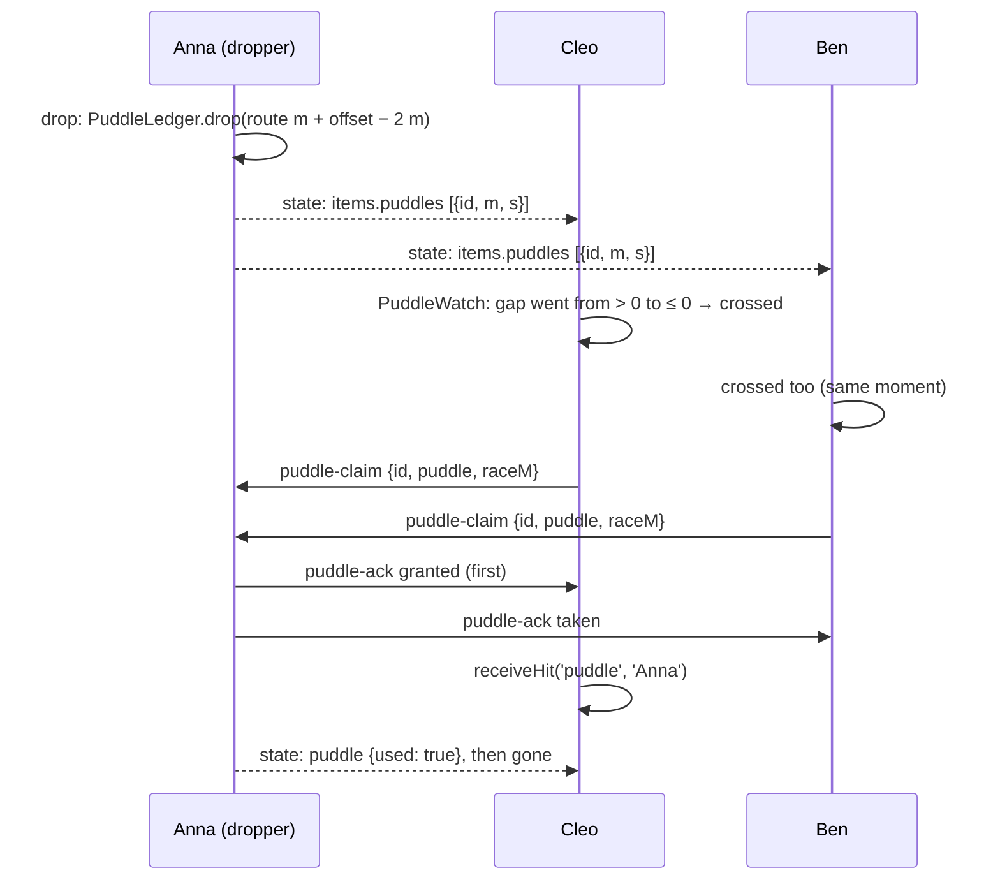

# ADR 0008 — Freilauf Rumble: items, the mud puddle as a world object, wire format v2

Status: accepted · 2026-11-25 · supersedes the card-based presentation and items of
[ADR 0007](0007-card-race.md); keeps its mechanics (attacks as events, signed race offset,
protection, compatibility by marking)

## Context

The battle mode of ADR 0007 was built from a misunderstanding: the maintainer asked for a mode
"like Kart" — go-kart racing games, where racers pick up items on the track and use them on each
other — and it was heard as "card". The mechanics were right; the presentation (a hand of
cards) and some of the items were not. The approved redesign, rider guide
[rumble.md](../rumble.md):

- the name **Freilauf Rumble** everywhere user-facing (one constant, `RUMBLE_NAME`); original
  items, none of a commercial game's names, shapes or looks;
- **feed bags** at the roadside instead of gates: riding past one gives a random item (same
  spacing and seeding as the power-up spots); the effort challenge gives one too;
- **two item slots** (left/right side button, P and L);
- attacks — a **water bottle** thrown at the rider directly ahead, a **mud puddle** dropped
  behind you, **hornets** that chase the leader — a **rain cape** as defence, the four boosts,
  and protection after any hit, as before;
- every hit moves only the target's race position; never the recording, points or the trainer's
  resistance; visible in the scene on both screens;
- the puddle is new: a **world object** at a position, not aimed at anyone. Everyone must see
  the same puddle at the same place, exactly one rider may be hit by it, decided fairly without
  a server, and never the dropper.

The network: the 4 Hz rider-state broadcast is unreliable and unordered on the self-hosted mesh
and reliable and ordered on the relay transport ([ADR 0003](0003-signalling-via-public-relays.md)).
The format has never been released, so it may change freely, but an app speaking the old one
must be treated as one without the mode, never crash.

## Decision

### 1. Items and magnitudes (engine, `renderer/core/powerUps.ts`)

"Slowed" is more air resistance in the race-offset shadow bike (ADR 0006/0007), sized so a hit
costs about what a boost gains — at 200 W on the flat a Tailwind gains ≈ 19 m, a Slipstream
≈ 24 m:

| Item         | Use                             | Effect on whoever it hits                                           | ≈ loss at 200 W, flat |
| ------------ | ------------------------------- | ------------------------------------------------------------------- | --------------------- |
| Water bottle | aimed: the rider directly ahead | CdA × 2.0 for 10 s                                                  | 25 m                  |
| Mud puddle   | dropped 2 m behind the rider    | CdA × 3.0 for 5 s; it dries up after 60 s                           | 24 m                  |
| Hornets      | aimed: the leader, however far  | CdA × 2.2 for 8 s, and the gaps show "?" on the leader's own screen | 24 m                  |
| Rain cape    | on yourself, up to 60 s         | keeps off the next hit of any kind                                  | —                     |

Boosts as before (Tailwind, Slipstream, Light load, Downhill momentum). `PROTECTION_S = 15`
after a hit ends (or after the cape kept one off). The **rain cape blocks a puddle** too: an
item that waits to be used should protect against every hit, and a cape that let mud through
would need explaining. The puddle is then used up by the cape.

Pool (`RUMBLE_POOL`, one entry per chance, 15 in all): each boost × 2 (8 of 15 help yourself),
water bottle × 2, mud puddle × 2, rain cape × 2, hornets × 1 (the strongest reach). Pick-up
spots and the item at each come from the same seeded generator as power-ups, so on a route
everyone meets the same feed bag with the same item.

API: `setMode('normal' | 'rumble')`, `activate(slot)` (boosts, cape), `spendItem(slot)` /
`returnItem(kind)` (bottle, hornets, puddle), `receiveHit(kind, by)` for every hit, and
`hitCheck()` — what a hit would meet now (`unavailable`, `protected`, or null).

### 2. Wire format v2 (`@freilauf/p2p`, `rumble.ts`)

Mode: `rules.mode` is `'normal' | 'rumble'`; any other value (also ADR 0007's `'cardRace'`)
counts as normal.

Capability marker and state: every Rumble-capable client sends **`items`** (a new field name)
with **`v: 2`** in every group ride; outside a Rumble it is just `{ "v": 2 }`.

```jsonc
"items": {
  "v": 2,                                     // Rumble protocol version
  "offsetM": -14.2,                           // the signed race offset (Rumble only)
  "hit": { "kind": "bottle", "s": 6.5 },      // a hit slowing this rider, s left
  "capeS": 41.0,                              // rain cape on, s left
  "protectedS": 21.5,                         // s until a hit can land again
  "held": 2,                                  // items held
  "away": true,                               // paused / ERG / FTP test / items off
  "puddles": [                                // this rider's puddles (at most 4)
    { "id": "q8x2m1zz.3", "routeId": "isar-loop", "m": 4213.5, "s": 41.2 },
    { "id": "q8x2m1zz.2", "m": 3990.0, "s": 0, "used": true }
  ]
}
```

Validation (a malformed optional field drops the packet, as for every field): `v` integer
2 … 1000, timers 0 … 600 s, `kind` `^[a-z][a-zA-Z]{0,23}$`, `held` 0 … 8, puddle ids
`<epoch>.<seq>`, `m` −100 km … 11 000 km, `routeId` a route id, at most 4 puddles with distinct
ids.

Messages (each ≤ 512 bytes, `v: 2`; version-1 messages are not decoded):

```jsonc
{ "v": 2, "type": "rumble-attack", "id": "k3j2a9x1.4", "to": "<peer>", "kind": "bottle",
  "gapM": 38.5, "raceM": 4231.0, "routeId": "isar-loop" }
{ "v": 2, "type": "rumble-ack", "id": "k3j2a9x1.4", "result": "hit" } // blocked | protected | unavailable | refused
{ "v": 2, "type": "puddle-claim", "id": "c7d1p0aa.2", "to": "<dropper>", "puddle": "q8x2m1zz.3",
  "raceM": 4214.0, "routeId": "isar-loop" }
{ "v": 2, "type": "puddle-ack", "id": "c7d1p0aa.2", "result": "granted" } // taken | gone | refused
```

Attacks (bottle, hornets) are delivered exactly as in ADR 0007 §2: an outbox re-sends every
400 ms on the mesh until the target's ack (once on the relays), one outcome per attack (or
`timeout` after 5 s); an inbox per sender remembers the last 64 verdicts (duplicates get the
same answer without being applied again, older ids are refused as replays), rate-limits (3 per
30 s, 1 s apart); the app then checks plausibility (known aimed item; the target is ahead of the
thrower's own `raceM` within 20 m; the gap roughly agrees; bottle: nobody in the race between;
hornets: nobody in the race ahead) and the engine decides (`receiveHit`).

### 3. The mud puddle: a world object, decided by its dropper



- **Placement.** The dropper's `PuddleLedger` records the puddle at its own race position minus
  2 m: on its route (`routeId` + route metres + race offset, wrapped on a loop), otherwise as a
  ridden-distance race position. These are exactly the coordinates `RemoteRiders` places riders
  by, so every rider sees the puddle where the dropper was, relative to everyone else.
- **Broadcast.** The dropper sends its puddles in `items.puddles` with the seconds left (no
  clock sync needed). A used puddle is sent with `used: true` for 3 s, then left out; a dry one
  is left out. At most two puddles per rider lie on the road at once.
- **Crossing.** Each rider checks for itself (`PuddleWatch`): the gap to each remote puddle on
  its road (same route, or both off-route), and a crossing is that gap going from ahead (> 0) to
  reached (≤ 0) in one step of at most 80 m. A puddle first seen behind is never crossed, a jump
  along the route is no crossing, used or dry puddles are ignored, and **a rider's own puddles
  are not in the list** (they are not remote riders) — so the dropper can never be hit by its
  own puddle. A rider who could not be hit now (`hitCheck()`: protected, paused, ERG, items
  off) rolls through without claiming; the puddle stays for the next one.
- **Claim.** The crosser sends `puddle-claim` to the dropper, delivered like an attack
  (re-sent every 400 ms on the mesh with its latest position, decided once per id, rate limit
  6 per 30 s). Only a `granted` claim hits: the claimer then calls `receiveHit('puddle', …)`,
  where a rain cape keeps it off.
- **Decision (the dropper is the only judge).** `PuddleLedger.decide`, in order: unknown or
  dried up (1 s grace for claims in flight) → `gone`; another route, or the claimer's `raceM`
  not between 30 m short of and 250 m past the puddle → `refused` (the puddle stays); already
  hit → `granted` again for the same claimer (its re-send after a lost ack, under a new id),
  `taken` for anyone else; otherwise this claimer is the one → `granted`, the puddle is used up.
  The app adds one check first: the claimer must be a rider in the race (a Rumble app, not
  `away`), else `refused`.

**Why exactly one rider is hit, without a server:** the dropper's app processes messages one at
a time and its ledger marks the puddle used at the first plausible claim, so of two claims
arriving "at once" one is first and the other is told `taken` (**ties** are broken by arrival
order at the dropper). A claimer applies a hit only on `granted`, and the outbox reports one
outcome per claim, so a claimer is hit at most once. **Lost messages:** a lost claim is re-sent;
a lost ack is answered again with the same verdict (the inbox remembers it, and the ledger
answers a repeat by the same rider `granted`); if nothing gets through for 5 s the claim times
out and the claimer is not hit — if the dropper had already granted it, the puddle is used up
without a hit (the one failure mode: _at most_ one rider, never two). A dropper who leaves takes
its puddles with it (they disappear from everyone's view; open claims time out).

Alternatives considered for the puddle:

- **Every rider decides alone** ("I crossed it, I am hit"): two riders crossing together would
  both be hit, and nothing could make the puddle disappear for everyone at the same time.
- **Lowest peer id wins a tie**: needs every claimer to know every other claimer, i.e. a
  broadcast round and a wait before anyone is hit.
- **The puddle as an attack on the rider behind**: not a world object — it would have to be
  aimed when dropped and could not wait on the road for whoever comes along.

### 4. Old-format apps: "does not support Freilauf Rumble"

An app of ADR 0007's format sends `cards: { v: 1, … }` and `rules.mode: 'cardRace'`. The new
validator does not read `cards` (an unknown field, ignored), so such an app has no `items` and
is marked in the room ("Anna's app does not support Freilauf Rumble: they ride along with normal
power-ups and nothing can hit them"), passed over as a target, not counted by the target-side
checks, and its puddle claims are refused. Its `card-attack` / `card-ack` messages are not
decoded (only `v: 2` with the new types is), so it cannot hit anyone; the new messages are
unknown types to it and ignored. Its host's `'cardRace'` mode is unknown here and counts as
normal; our `'rumble'` is unknown there and counts as normal. The plain `raceOffsetM` stays ≥ 0
for every old validator.

### 5. Presentation

Two item slots along the bottom of the scene (a round pocket each, left slot bottom left, right
slot bottom right), what acts on the rider between them, a notice at the top (hit notices are
never pushed off by item cues), and a marker at the scene's back edge while a bottle or the
swarm flies in from behind. Both scenes draw the feed bags, the bottle's arc from thrower to
target (out of the frame ahead when the target is further than the view), the swarm along the
road, the puddle on the road for riders approaching it, a splash of water or mud on a hit, the
cape, and the effects on other riders. The overlay shows the hit, the slots with their keys, a
puddle ahead, the cape or protection. Colours are tokens (`--rumble-attack`, `--rumble-guard`,
`--rumble-water`, `--rumble-mud`, `--rumble-hornet`); with reduced motion everything is drawn
still.

## Consequences

- The recording stays untouched by construction: items and hits never reach `RideSession`,
  `stepBike` or the trainer commands. `rumble.integration.test.ts` rides the same three-rider
  ride with and without a bottle, and with and without a puddle ridden through, and compares the
  hit rider's `RecordedRide`, `.fit` bytes, community facts and every trainer command.
- A normal ride is unchanged on the engine side and adds `"items":{"v":2}` to the broadcast.
- The dropper is the authority for its own puddles; if it leaves, they vanish.
- Tests: engine (`powerUps.rumble.test.ts`: slots, pool and weights, each item's effect and
  duration, cape against every hit, protection), protocol (`rumble.test.ts` in p2p: v2
  messages, validation, inbox/outbox for attacks and claims, `PuddleLedger`, `PuddleWatch`, the
  superseded format), both transports with loss/duplicates/reordering (`groupRumble.test.ts`:
  attacks exactly once; two simultaneous claimants → exactly one `granted`; lost acks;
  unknown/used/implausible claims), three riders with real controllers on both transports
  (`rumble.integration.test.ts`), the scene bookkeeping (`powerUpScene.test.ts`), server-rendered
  UI (`rumbleUi.test.ts`), and two app instances over a local signalling server
  (`e2e/rumble.spec.ts`: a bottle thrown at the rider ahead, a puddle ridden through).
