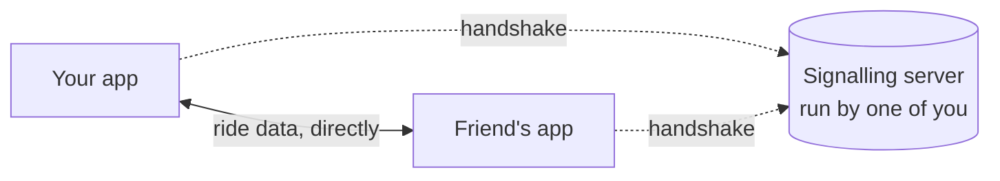

# Ride with friends

Group rides put up to eight riders in one room: you see each other's power, speed and gap,
can share a workout and start it together. This page is for riders. The protocol and the code
are described separately in [p2p.md](p2p.md) (technical).

- [How it works](#how-it-works)
- [Join a friend's ride](#join-a-friends-ride) — 30 seconds, nothing to set up
- [Host rides for your friends](#host-rides-for-your-friends) — one person runs a small server
- [Privacy: what the server sees](#privacy-what-the-server-sees)
- [Cost and size](#cost-and-size)
- [Troubleshooting](#troubleshooting)
- [Limits](#limits)

## How it works

Your apps talk to each other **directly** over the internet — power, speed, heart rate,
position and shared workouts go from rider to rider, encrypted, and never through a server.

To _find_ each other, though, the apps need a meeting point that everyone can reach: a small
**signalling server**. It passes on a few short handshake messages when someone joins, and
that is all it does. There are no accounts.



**Freilauf has no public server.** One person in your group — the _host_ — runs one, once,
and everyone else uses it through the invite link. The host's server is one small container,
and if you already run the [web version with Docker](docker.md), you already have it.

## Join a friend's ride

1. Your friend sends you an **invite link**. It looks like
   `freilauf://join/ABCDEF?s=wss%3A%2F%2Fsignal.example.org`.
2. Open the **Group** tab, paste the link into **A friend invited me** (or the "Join" field)
   and click **Join**. You can paste the whole message the link came in.

That is all. The link contains the address of your friend's server, so you do not need to set
anything up, and your own settings are not changed.

Clicking the link does not open Freilauf yet — copy it and paste it into the Group tab.

**Just a code?** A six-character code such as `ABC-DEF` only works if you have entered the
_same_ server address as the host in **Settings → Group**. If you have no server set up, the
app says so and asks for the link. If you have a different server set up, the code opens a new,
empty room there — the app then shows "Nobody else is here yet". The link avoids both.

## Host rides for your friends

You need a signalling server that your friends can reach from the internet, over HTTPS
(`wss://`). Pick the way that matches what you already have; each ends with an address that
you enter **once** in Freilauf.

> Status: the server itself and the app's side are tested end to end, but **group rides
> between different homes have not been tried yet**, the Docker images have not been built and
> run in a real deployment, and the NAS steps were written from the documentation, not on a
> real device. Please report what worked and what did not.

### (a) You already run the Docker / web version

The web version's container is also a signalling server, at the path `/signal` on the same
address. If you reach your web version at `https://freilauf.example.org` and that address
works from outside your home (see (b) for a NAS), **your address is
`wss://freilauf.example.org/signal`**.

- Riders who open your web version use it automatically; nothing to enter.
- In the desktop app, enter it once in **Settings → Group** (or in the Group tab under
  **I want to host**).

If your web version is only reachable at home (`http://<nas-ip>:8080`), friends elsewhere
cannot reach it — continue with (b).

### (b) On a NAS with a reverse proxy (example: Synology)

The [Docker guide](docker.md#synology-nas-container-manager--reverse-proxy) covers running the
container on a Synology NAS and putting it behind DSM's built-in reverse proxy with a free
Let's Encrypt certificate — follow its steps 1 and 2. For group rides, three things matter in
addition:

1. **Reachable from the internet.** Your router must forward port 443 (or the HTTPS port you
   chose) to the NAS, and the host name (for example a free `*.synology.me` DDNS name) must
   point to your home's public address. Some internet connections (CGNAT, many mobile and some
   fibre connections) do not allow incoming connections at all; then use (c).
2. **WebSocket on.** In the reverse-proxy entry, **Custom Header → Create → WebSocket** must
   be added. Without it, the page loads but group rides fail.
3. **Your address is `wss://freilauf.yourname.synology.me/signal`** (your host name, with
   `wss://` and `/signal`). Enter it once in **Settings → Group**.

Other NAS systems with a reverse proxy work the same way: an HTTPS entry with a valid
certificate that forwards to the container's port and passes WebSocket upgrades through.

These steps were written for DSM 7.2 and have not been verified on a real NAS.

### (c) On any small server

A small rented server (VPS) with a public address and a domain name pointing to it is enough.
Run only the signalling server, and put a web server with automatic HTTPS in front of it. From
a copy of this repository on that server:

```sh
docker build -t freilauf-signalling apps/signalling
docker run -d --restart unless-stopped --name freilauf-signalling \
  -p 127.0.0.1:8787:8787 freilauf-signalling
```

Then, for example with [Caddy](https://caddyserver.com/), which fetches the certificate itself:

```caddyfile
signal.example.org {
  reverse_proxy 127.0.0.1:8787
}
```

**Your address is `wss://signal.example.org/signal`** (the standalone server answers on any
path, so `wss://signal.example.org` works too). Enter it once in **Settings → Group**.

nginx, running without Docker, and the server's settings are in
[the signalling server's README](../apps/signalling/README.md).

### Check that it works

- **In the app:** Group tab → **Test connection**. It reports _Reachable_, _Not reachable_
  (nothing answered — server off, wrong address, or not reachable from this network) or _Not a
  signalling server_ (something answered, but not Freilauf — usually a wrong path or a proxy
  without WebSocket support). If only the path is wrong, it offers the right address.
- **From a browser or a terminal:**

  ```sh
  curl https://signal.example.org/healthz        # → ok
  curl -i https://signal.example.org/signal      # → HTTP 426 "… connect via WebSocket"
  ```

  `/healthz` answering `ok` shows the container runs and the proxy forwards to it. The `426`
  answer on the signalling address shows that requests reach the signalling server; it does not
  prove that the proxy passes WebSockets through — the in-app test does.

Test from outside your home network too (for example a phone without Wi-Fi), because that is
where your friends are.

### What to send your friends

Click **Create group ride** and then **Copy invite link**, and send the link in any message.
Friends only need that link — no server address, no account. A new link is made for every
ride; the room exists as long as at least one rider is in it.

## Privacy: what the server sees

The signalling server (`apps/signalling/src/server.ts`) keeps, **in memory only and only while
a rider is connected**:

- the **room code**,
- a random **peer id** per rider,
- the **name each rider chose** (Settings → Rider → Name).

It writes nothing to disk and keeps no history; a room is gone when its last rider leaves or the
server restarts.

While someone joins, it **passes on the WebRTC handshake** (connection offers and answers and
"ICE candidates") between the riders in a room, without reading or storing it. Those messages
contain the network addresses at which your computer can be reached — typically your public IP
address — because that is how a direct connection gets set up; the other riders in the room
learn them as well. Like any server, it also sees the IP address each connection comes from.

**Logs.** By default the server logs only one line when it starts. With `LOG_LEVEL=debug` it
also logs when a room opens and closes, including the **room code**; the web version then also
logs the method and path of each web request. Freilauf's server never logs IP addresses or
names. Your reverse proxy (Caddy, nginx, the NAS) may log IP addresses and paths according to
its own settings.

**Elsewhere.** To find its public address, each rider's app asks public STUN servers
(`stun.l.google.com` and `stun.cloudflare.com`), which therefore see that rider's IP address.
Ride data, shared workouts and community standings go directly between the riders' apps over
encrypted WebRTC connections, never through the signalling server.

## Cost and size

- **What runs:** one Node.js process. The standalone image is built on `node:22-alpine` with a
  single dependency (`ws`); the web-version image adds the built web app. The image sizes have
  not been measured yet.
- **Memory:** about 80 MB for an idle server process (measured with Node 22 on Linux, outside a
  container).
- **Traffic:** a handful of short text messages per rider joining, plus a ping every 30 seconds
  per connected rider. Ride data does not go through the server.
- **Cost:** nothing extra if it runs on a NAS or server you already have; otherwise the
  smallest plan of any VPS provider and a domain name, or a free DDNS name.

## Troubleshooting

The Group tab shows these messages; the details of every failure are also written to the
[diagnostic log](diagnostics.md).

| Message in the app                          | What it means                                                                                                           | What to do                                                                                                                                             |
| ------------------------------------------- | ----------------------------------------------------------------------------------------------------------------------- | ------------------------------------------------------------------------------------------------------------------------------------------------------ |
| **A code alone is not enough here**         | You entered a code, and this app has no server set up.                                                                  | Ask for the whole invite link and paste that.                                                                                                          |
| **That is not an invite**                   | No link or room code was found in what you pasted.                                                                      | Paste the link that starts with `freilauf://join/`, or the six-character code.                                                                         |
| **You appear to be offline**                | This computer has no network connection.                                                                                | Check Wi-Fi or cable, then try again.                                                                                                                  |
| **Server not reachable**                    | Nothing answered at the address: the server is off, the address is mistyped, or it is not reachable from where you are. | Host: run **Test connection**, test from outside your home, check port forwarding. Guest: ask the host to check, then try the link again.              |
| **That address is not a group-ride server** | Something answered, but not a Freilauf signalling server.                                                               | Check the path (`/signal` for the web version) and that the reverse proxy passes WebSockets through (on Synology: the _WebSocket_ custom header).      |
| **This ride is full**                       | The room already has 8 riders.                                                                                          | Start a second ride.                                                                                                                                   |
| **Nobody else is here yet** (after joining) | You are in the room, but alone. A wrong code does not fail — it opens a new, empty room.                                | Check the code, or use the invite link: it also makes sure you are on the host's server.                                                               |
| **Cannot reach _name_ directly**            | You are both in the room, but your computers cannot connect to each other directly.                                     | Usually a restrictive network (some mobile, company or university networks). Try another network for one of you, e.g. home Wi-Fi instead of a hotspot. |
| **The server address is not valid**         | The saved address does not start with `ws://` or `wss://`.                                                              | Correct it in **Settings → Group**.                                                                                                                    |
| The link does nothing when clicked          | The app does not open `freilauf://` links from the operating system yet.                                                | Copy the link and paste it into the Group tab.                                                                                                         |

More checks for the web version are in the [Docker guide](docker.md#troubleshooting).

## Limits

- **Up to 8 riders** per room; everyone connects to everyone.
- **No relay for difficult networks.** Freilauf uses public STUN servers only, no TURN relay.
  Riders behind some networks — "symmetric NAT", common with mobile carriers, CGNAT and some
  company or university networks — cannot connect directly; the app shows them as "cannot
  connect". The technical background is in [p2p.md](p2p.md#nat-traversal-caveat).
- **Trust-based.** Anyone with the link or code can join the room, and names are not verified.
  There is no anti-cheat. Ride with people you know.
- **The server is needed to join**, not to keep riding: riders already connected keep riding if
  it goes away, but nobody new can join until it is back.
- **No public server**, and links are not opened from the operating system yet (see above).

### Trying it on one computer

To see group rides without any setup, run a server on your own computer — from the source
folder, `pnpm signalling` — and in the Group tab choose **Use a server on this computer (for
testing)**. Then a second copy of the app (or the web version) on the same computer can join
with the invite link. Friends elsewhere cannot reach a server on `localhost` or `127.0.0.1`.
