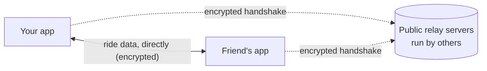

# Ride with friends

Group rides put up to eight riders in one ride: you see each other's power, speed and gap,
can share a workout and start it together. **There is nothing to set up** — no server, no
account. This page is for riders; the protocol and the code are described in
[p2p.md](p2p.md) (technical).

> **Status:** the zero-setup path described here is new and **has not been verified on real
> networks yet** — it cannot be tried from the project's test machines. If you try it, please
> report what happened (see [Help us verify it](#help-us-verify-it)). Until then, the
> [own signalling server](#advanced-your-own-signalling-server) remains available as a
> fallback.

- [Start a ride and invite friends](#start-a-ride-and-invite-friends)
- [Join a friend's ride](#join-a-friends-ride)
- [Card Race](#card-race)
- [How it works](#how-it-works)
- [Privacy: what the relay servers see](#privacy-what-the-relay-servers-see)
- [When it does not work](#when-it-does-not-work)
- [Troubleshooting](#troubleshooting)
- [Limits](#limits)
- [Advanced: your own signalling server](#advanced-your-own-signalling-server)

## Start a ride and invite friends

1. On the start screen, under **With whom**, choose **Group ride** and click **Create group
   ride**.
2. An **invite link** appears at once, for example
   `freilauf://join/ABCDEF#GHJKMNPQRSTU`. Click **Copy invite link** and send it in any
   message.
3. Below it, the status says _Looking for the relay servers…_ and, a moment later, _Ready:
   friends with the invite can find you_. Friends who paste the link show up under **In the
   room**; a workout or route one of them shares appears right there ("Ben shares the workout
   ‘VO2max 5×4’") with **Use it**.
4. **Start riding** — or **Start together in 10 s**, which starts everyone's ride at the same
   moment. During the ride, **Group** in the ride view's toolbar shows the riders (gap, power,
   heart rate, speed) and the invite.

Hosting and joining are the same now: whoever starts the ride sends the link. A new ride has a
new link; the ride exists as long as at least one rider is in it.

**Reading it out instead?** The invite also has a written form, the **invite code**, e.g.
`ABC-DEF-GHJK-MNPQ-RSTU`, shown next to the link with its own copy button. Your friend can type
it under **Group ride** on their start screen. The **whole** code is needed: the first six characters alone are only
the room's name, not its key (see [Privacy](#privacy-what-the-relay-servers-see)). The last
character is a check, so a mistyped or misheard code is caught at once ("The invite has a
typo") instead of opening an empty ride.

## Join a friend's ride

On the start screen choose **Group ride**, paste the link (or type the invite code) into the
**Paste an invite** field and click **Join**. You can paste the whole message the link came in. That is all — your settings
are not changed.

Clicking the link does not open Freilauf yet — copy it and paste it under **Group ride** on the
start screen.

## Card Race

Whoever creates the ride can make it a **Card Race** instead of a normal ride: choose **Card
Race** above **Create group ride**. Everyone then holds two cards, played with the left and
right side buttons (P and L): boosts for yourself, a **Headwind** for the rider directly ahead,
**Fog** for the leader, a **Shield**. Attacks are short, every hit is followed by protection, and
only race positions move — recorded rides and the trainer's resistance never change. Everyone
in the room sees the mode; the host can switch it at any time. A rider whose app has no Card
Race is named in the room and rides along with normal power-ups. All about it:
[card-race.md](card-race.md).

## How it works

Your apps talk to each other **directly** over the internet — power, speed, heart rate, position
and shared workouts go from rider to rider over encrypted WebRTC connections.

To _find_ each other, the apps need a meeting point. Freilauf has no server of its own for
that: it uses a handful of **public relay servers** (Nostr relays) that are **run by others**
and used by many apps. Each app connects to them and leaves a short, **encrypted** handshake
message for the others in the same ride; once the handshake is through, the riders are
connected directly and the relays are no longer needed for that pair.

The library doing this is [Trystero](https://github.com/dmotz/trystero) (MIT licence); the
decision and its trade-offs are recorded in
[ADR 0003](adr/0003-signalling-via-public-relays.md).

## Privacy: what the relay servers see

The invite contains a **room code** (the six characters after `join/`) and a **secret** (the
part after `#`). The secret never leaves the riders' apps: it is the key for the handshake.

The relay servers see:

- each rider's **IP address** (like any server you connect to) and when they connect;
- a **hashed room name** — with effort, the six-character room code can be guessed from it,
  but not the secret;
- short **encrypted** handshake messages and their timing, signed with throwaway keys.

The relay servers do **not** see: your name, the secret, the contents of the handshake (which
include your computers' network addresses), ride data, shared workouts or community standings.
They cannot join the ride or read along without the secret.

**Elsewhere.** To find its public address, each app asks public STUN servers
(`stun.l.google.com`, `stun.cloudflare.com`), which therefore see that rider's IP address.
The other riders in the ride learn your network addresses — that is how a direct connection is
made — and the name you chose in **Settings → Rider**.

## When it does not work

- **No relay reachable.** If none of the relay servers can be reached from your network — some
  company, school, hotel or public networks block them, or they are all down — the app says
  _No relay server reachable_ within about 15 seconds. Try another network (home Wi-Fi, a phone
  hotspot). Riders who are already connected keep riding if the relays go away; only new
  riders cannot join until one is back.
- **No direct connection.** Freilauf has no relay for ride data (no TURN). Riders behind some
  networks — "symmetric NAT", common with mobile carriers, CGNAT and some company or university
  networks — cannot connect directly. The app then says that a rider _could not be reached
  directly_. Switching one of you to another network usually helps. The technical background is
  in [p2p.md](p2p.md#nat-traversal-caveat).
- **A different secret.** Someone with the right room code but another secret cannot get in;
  the app notes it. Usually an old or shortened invite — send the whole link again.

## Troubleshooting

The group section of the start screen (and the ride view's **Group** panel) shows these
messages; the details of every failure are also written to the
[diagnostic log](diagnostics.md).

| Message in the app                          | What it means                                                            | What to do                                                                                                            |
| ------------------------------------------- | ------------------------------------------------------------------------ | --------------------------------------------------------------------------------------------------------------------- |
| **No relay server reachable**               | None of the public relay servers answered from this network.             | Check the internet connection; try another network. If it keeps failing, see [Help us verify it](#help-us-verify-it). |
| **You appear to be offline**                | This computer has no network connection.                                 | Check Wi-Fi or cable, then try again.                                                                                 |
| **This code is missing its secret part**    | You entered only the six-character room code.                            | Ask for the whole invite link, or the full code `ABC-DEF-GHJK-MNPQ-RSTU`.                                             |
| **The invite has a typo**                   | It looks like an invite, but a character is wrong, missing or extra.     | Copy the link again, or compare the code character by character.                                                      |
| **That is not an invite**                   | No link or code was found in what you pasted.                            | Paste the link that starts with `freilauf://join/`.                                                                   |
| **This ride is full**                       | The ride already has 8 riders.                                           | Start a second ride.                                                                                                  |
| **Nobody else is here yet** (after joining) | You are in the ride, but alone so far.                                   | Wait a few seconds; check that the link is from your friend's current ride.                                           |
| A rider _could not be reached directly_     | You found each other, but your computers cannot connect directly.        | Usually a restrictive network. Try another network for one of you, e.g. home Wi-Fi instead of a hotspot.              |
| _Someone tried to join … different secret_  | Someone used this ride's code with another secret.                       | Send your friend the whole invite link again.                                                                         |
| The link does nothing when clicked          | The app does not open `freilauf://` links from the operating system yet. | Copy the link and paste it under **Group ride** on the start screen.                                                  |

### Help us verify it

The relay path could not be tested from the project's machines (they cannot reach public
relays). If you try a ride between two homes, please send: whether it worked, both networks
(home Wi-Fi, mobile hotspot, company …), and the lines tagged `p2p` from the diagnostic log
(**Settings → Diagnostics → Export log**; names and invite codes are masked). The lines that
matter: `joining via public relays`, `relay connected` (with `relaysOpen` / `relaysNotOpen`),
`peer connected`, `no direct connection to a peer`, `a peer used another secret`, `giving up:
no-relay`, `could not enter the group`.

## Limits

- **Up to 8 riders** per ride; everyone connects to everyone.
- **No relay for ride data (no TURN)** — see [When it does not work](#when-it-does-not-work).
- **Depends on relays run by others.** Freilauf does not run or control them. All riders use
  the same built-in set; at least one must be reachable from every rider's network.
- **Trust-based.** Anyone with the whole invite can join, and names are not verified. There is
  no anti-cheat. Ride with people you know.
- Links are not opened from the operating system yet (see above).

## Advanced: your own signalling server

Before the public relays, one person in the group had to run a small **signalling server**.
That path still works, as a fallback while the relay path is being verified: under **Group
ride** on the start screen, open **Advanced: use my own signalling server** (or **Settings →
Group → Advanced: own signalling server and relays**), switch **Use my own signalling server**
on and enter the address. Rides you create then go through that server,
and the invite link carries its address (`freilauf://join/ABCDEF?s=wss%3A%2F%2F…`). Friends
need nothing set up: such a link always uses the server it names, whatever their own setting
is. With the option on, a bare six-character code also joins through your server.

- **The server:** `apps/signalling` ([README](../apps/signalling/README.md)) — one small Node
  process or container, reachable from the internet over HTTPS (`wss://`). The Docker web
  version contains it at `/signal` on the same address ([Docker guide](docker.md)), so
  `wss://<your-host>/signal` is your address there.
- **Reachable from the internet:** a NAS behind a reverse proxy with a valid certificate
  (WebSocket forwarding on; on Synology the _WebSocket_ custom header), port forwarding on the
  router, or a small VPS. The [Docker guide](docker.md#synology-nas-container-manager--reverse-proxy)
  covers the Synology steps; the [signalling README](../apps/signalling/README.md) covers a VPS
  with Caddy or nginx.
- **Check it:** the **Test connection** button reports _Reachable_, _Not reachable_ or _Not a
  signalling server_ (and offers the right address if only the path is wrong). From a terminal:
  `curl https://signal.example.org/healthz` → `ok`.
- **What that server sees:** in memory only, while a rider is connected: the room code, a random
  peer id and the name of each rider, and the IP address of each connection; it passes on the
  (unencrypted) WebRTC handshake. By default it logs nothing but its start; with
  `LOG_LEVEL=debug` it logs room codes. Your reverse proxy may log IP addresses.
- **Its messages:** _Your signalling server is not reachable_, _That address is not a group-ride
  server_ (wrong path or no WebSocket forwarding), _The server address is not valid_, _No server
  address entered_.
- **Trying it on one computer:** run `pnpm signalling` in the source folder and choose **Use a
  server on this computer (for testing)** in the advanced section. Only windows on the same
  computer can join.
